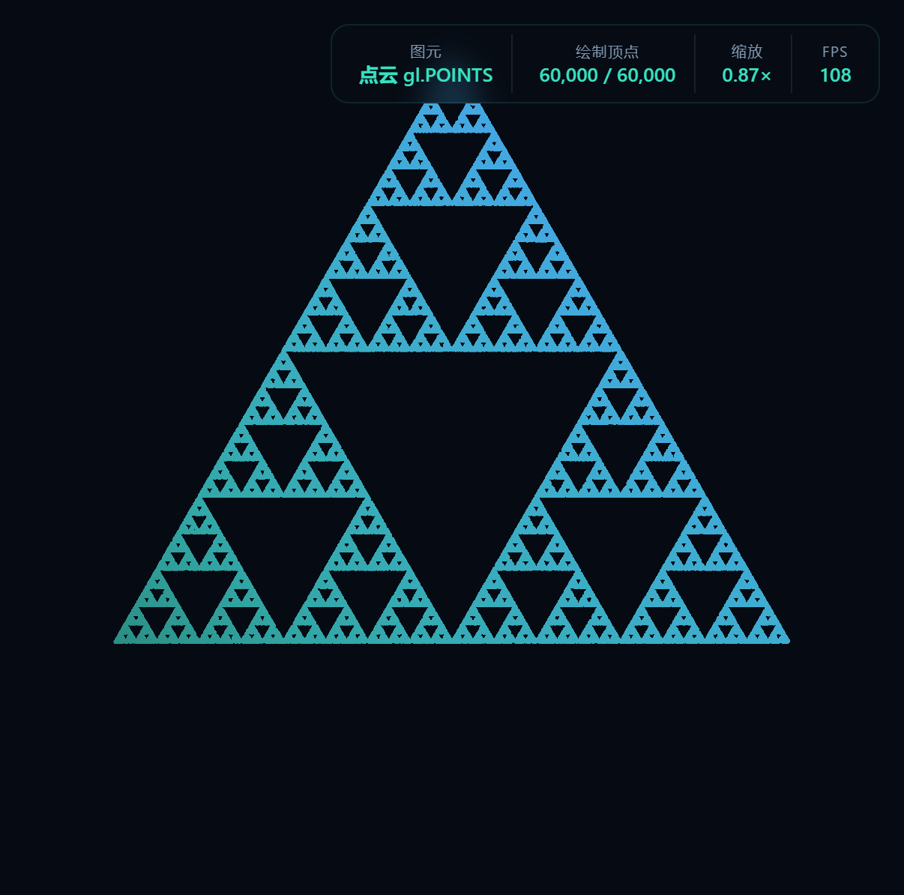
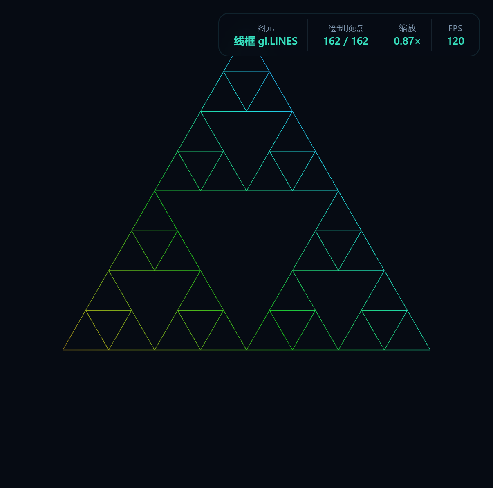
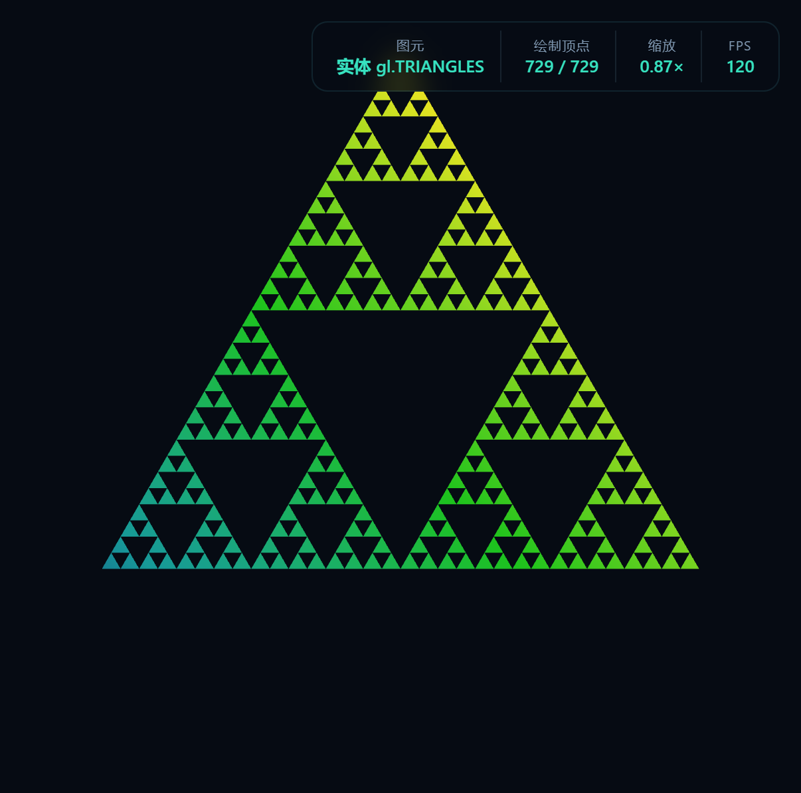

# AP1 · 交互式 2D 分形（WebGL 2.0）

## 一、两种生成算法

### 1. 混沌游戏（Chaos Game，随机迭代）

这个算法是从一组固定的顶点出发的，一开始有三个顶点，如果推广开来就是 n 个，然后程序反复做随机的缩放和平移：

```js
p = (p + 随机选中的一个顶点) / 2      // 每次把当前点向随机顶点"拉近一半"
```

从数学上看，这套规则属于迭代函数系统（IFS），它由三个变换组成，每个变换都把整个图形压缩一半，再分别挪到三角形的三个角上，而它最后稳定下来的那幅图，正好就是谢尔宾斯基垫片。程序的做法是先把初始点从单位圆里随机取一个，接着做 30 步"预热"，把还没稳定下来的过渡点跳过去，然后才把之后落下的每一个点记下来，当作渲染用的顶点；这些点最后由 `gl.POINTS` 画出来。

### 2. 递归细分（Recursive Subdivision）

这个算法靠 `subdivide(triangle, depth)` 来完成，做法是把三角形三条边的中点连起来，让三角形被一分为四，中间那个倒立的三角形会被丢掉，剩下的三个角上的三角形再被送去递归细分；当 `depth = 0` 的时候，手上那个三角形就被直接输出。

```js
subdivide(a, b, c, depth):
    if depth == 0: 输出三角形 abc; return
    ab, bc, ca = 三边中点
    丢弃中间三角形 (ab, bc, ca)
    subdivide(a,  ab, ca, depth-1)
    subdivide(ab, b,  bc, depth-1)
    subdivide(ca, bc, c,  depth-1)
```

因为每一步都把中心挖空了，所以最后得到的极限图形，和混沌游戏收敛出来的结果是一样的，也就是同一个谢尔宾斯基垫片；子三角形的个数可以由 `3^depth` 算出来。

---

## 二、交互操作说明

### 鼠标

| 操作 | 效果 |
|---|---|
| 左键按住拖动 | 视图被整体平移（`mousedown` / `mousemove` / `mouseup` 这几个事件是自己写的） |
| 滚轮上下滚动 | 视图被缩放，**缩放的中心是鼠标光标**（`wheel` 事件是自己监听的，`preventDefault` 拿来挡住页面滚动） |
| 滚轮左右拨动 | 既不缩放，也不会触发浏览器手势，只是被拦下来（见下） |

> **关于滚轮左右拨动**：当鼠标滚轮被左右拨动，或者触控板横向滑动的时候，浏览器会把它看成"后退 / 前进"的导航手势，于是页面就被切走了。
> 为了把它挡住，`window` 的**捕获阶段**上被注册了一个 `wheel` 监听，而且它不是被动的（`passive:false`）：只要不属于"参数面板内部的纵向滚动"，就一律 `preventDefault()`；
> 另外 `html, body` 上设了 `overscroll-behavior: none`，画布上设了 `touch-action: none`，从 CSS 这边再挡一层。这样一来，浏览器的导航既不会被误触发，缩放也不会被误触发。

### 键盘

| 按键 | 效果 |
|---|---|
| <kbd>1</kbd> | 把渲染模式换成**点云**（`gl.POINTS`） |
| <kbd>2</kbd> | 把渲染模式换成**线框**（`gl.LINES`） |
| <kbd>3</kbd> | 把渲染模式换成**实体**（`gl.TRIANGLES`） |
| <kbd>空格</kbd> | 把"生长"动画暂停或者继续（垫片：顶点数从 0 涨到设定值；复平面分形：迭代上限从 1 涨到设定值） |
| <kbd>R</kbd> | 把视角重置回默认的取景 |
| <kbd>Esc</kbd> | 把自检结果的弹窗关掉 |

> 混沌游戏只会产生一堆点，所以在选择"线框 / 实体"的时候，生成算法会被自动换成递归细分（面板里会有文字提示）。

### 参数面板

| 控件 | 说明 |
|---|---|
| 分形类型 | 谢尔宾斯基 / 曼德博集合 / Julia 集 |
| 生成算法 | 混沌游戏 / 递归细分 |
| 多边形边数 n | 混沌游戏用到的顶点个数（3–9） |
| 顶点数 | 点云用到的顶点个数（5000–200000） |
| 递归深度 | 细分的层数（0–6） |
| 渲染模式 | 点云 / 线框 / 实体 |
| 最大迭代 | 复平面分形的迭代次数上限（50–1000） |
| c 实部 / 虚部 | Julia 集的参数（模式切到 Julia 集时才出现） |
| 点大小 | 1–16 像素 |
| 配色方案 | 青瓷流光 / 霓虹彩虹 / 熔岩蓝橙 / 翡翠单色 / 星尘紫晶 |
| 生长速度 | 生长动画的快慢（进度/秒） |
| 播放生长 / 重置视角 | 和空格、R 效果相同的两个按钮 |

右侧的 HUD 会把当前用的是什么图元、已经画了多少个顶点以及顶点总数、缩放倍率和 FPS 都实时显示出来。

---

## 三、三种渲染模式截图

**① 点云（`gl.POINTS`）** —— 用的是混沌游戏，一共 60000 个点，点被画成圆的（靠 `gl_PointCoord` 裁出来）



**② 线框（`gl.LINES`）** —— 递归细分到深度 3，每个子三角形上只画三条边



**③ 实体（`gl.TRIANGLES`）** —— 递归细分到深度 5，一共 243 个实心的三角形


