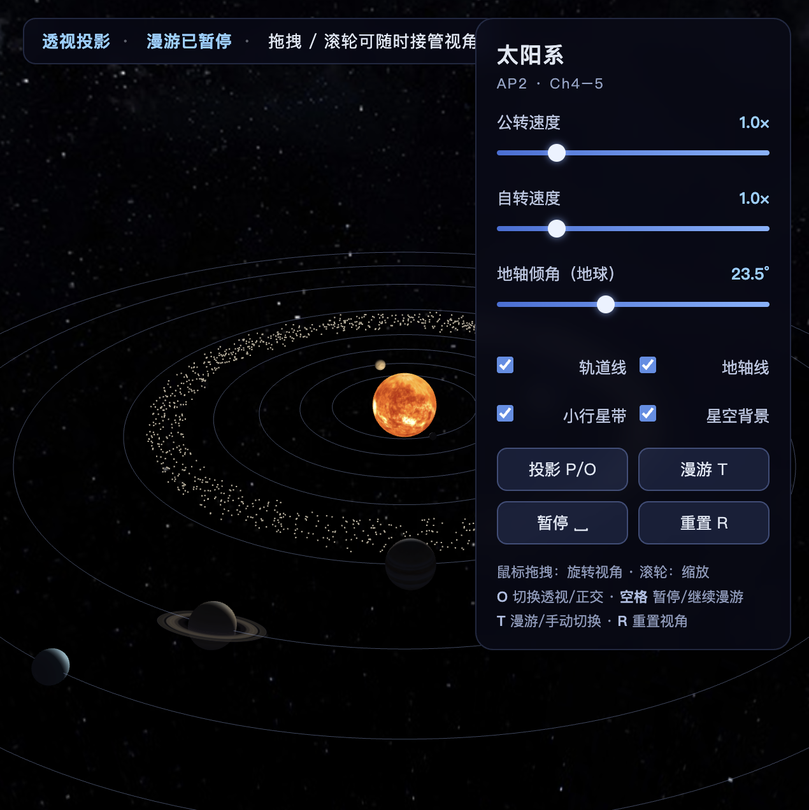
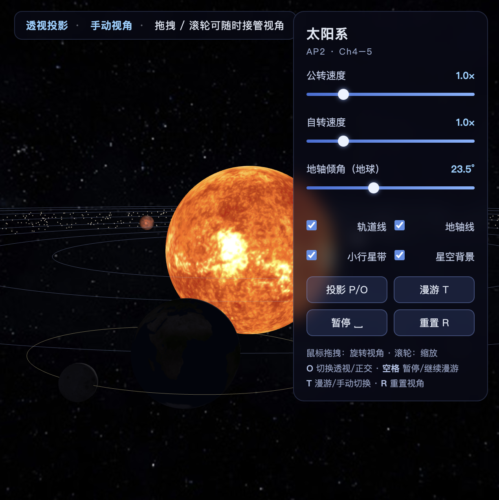
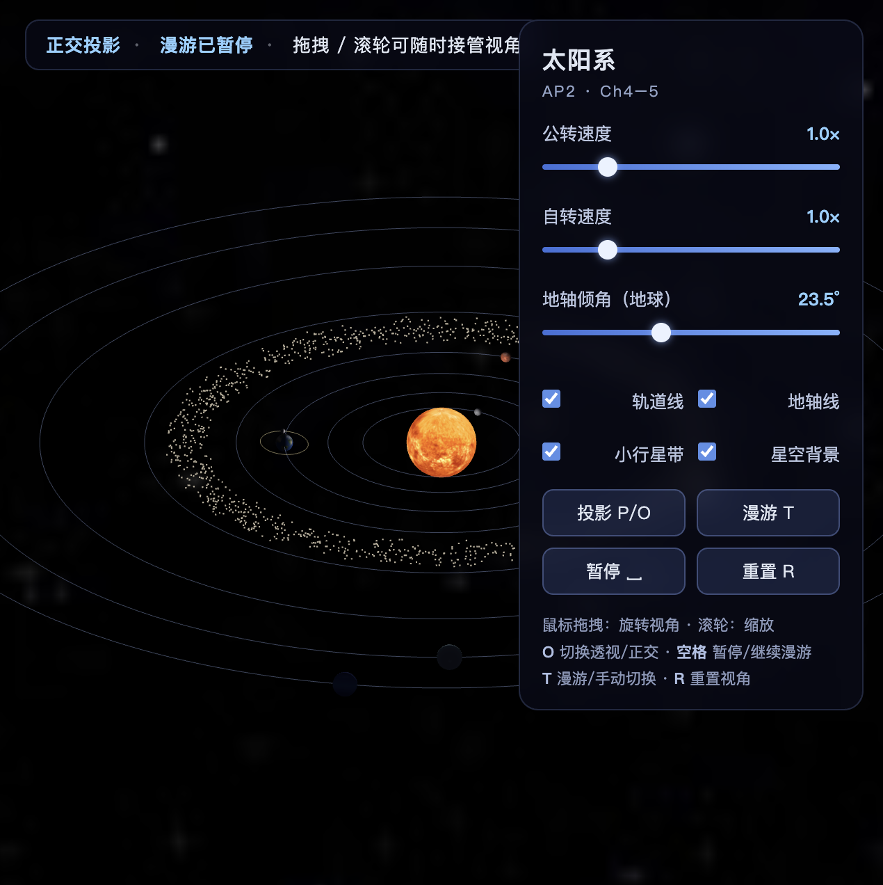

# AP2 · 三维层级场景：太阳系（WebGL 2.0）

> 课程：计算机图形学应用 · Assigned Project 2（对应教材 Angel & Shreiner, *Interactive Computer Graphics* 8th ed., Ch4–5）
> 技术栈：原生 WebGL 2.0（GLSL ES 3.00）+ 教材配套工具库 `Common/`（`initShaders.js` / `MV.js` / `webgl-utils.js`），无构建步骤。
> 完成度：必做 1–6 全部实现；选做 **E1 + E2 + E3 全部完成**（E1 完整太阳系 8 颗行星+土星环+小行星带；E2 日食/月食模拟；E3 虚拟轨迹球）。

| 全景 · 透视投影 | 地月系统特写 |
|---|---|
|  |  |

---

## 一、运行方式

### 本地运行

任意静态服务器指向本项目根目录即可，例如：

```bash
cd AP2-SolarSystem
python3 -m http.server 8000
# 浏览器打开 http://localhost:8000
```

> 必须通过 http:// 访问（VS Code Live Server、`python3 -m http.server` 均可）。
> 直接双击 index.html（file:// 协议）时浏览器会阻止图片纹理上传到 WebGL，画面将停留在灰色占位球。

### 公网访问（部署）

仓库推送到 GitHub 后：**Settings → Pages → Source 选 main 分支 / (root) → Save**，约 1 分钟后即可通过 `https://<用户名>.github.io/<仓库名>/` 直接访问。Gitee Pages / 个人主页同理。

---

## 二、交互说明

| 输入 | 功能 |
|---|---|
| 鼠标左键拖拽 | 旋转视角（**随时接管漫游相机**，状态条切到"手动视角"） |
| 滚轮 | 缩放（同样接管视角）；日食/月食视角下只调远近、不退出专用机位 |
| `O` | 切换 **透视 / 正交** 投影（面板按钮"投影"同效） |
| `空格` | 暂停 / 继续漫游 |
| `T` | 漫游 / 手动模式切换（回到漫游路径） |
| `R` | 重置视角 |
| `1` / `2` / `3` | **自由 / 日食 / 月食视角**（选做 E2，面板按钮同效；拖拽即退出专用机位） |
| `V` | **虚拟轨迹球**拖拽模式开关（选做 E3，再按 `V` 或 `R` 退出） |

参数面板（右侧）：

- **公转速度 / 自转速度**：0–5× 倍率滑条，实时生效；
- **地轴倾角（地球）**：0–60° 滑条，拖动可直观看到地轴线（青色）倾角变化——用于演示"先倾斜、后公转"的层级顺序；
- **轨道线 / 地轴线 / 小行星带 / 星空背景**：显示开关；
- **自由视角 / 日食 / 月食 / 轨迹球**：E2/E3 的视角切换按钮（按下高亮）。

## 三、漫游说明（对应交付物"漫游录屏 10 秒"）

按 `T`（或首次加载默认）进入漫游：相机沿 6 个关键帧（球坐标方位角 θ、仰角 φ、距离 d）**周期 Catmull-Rom 插值**绕场景一周（36 s，末帧无缝接回首帧），途中俯冲拉近内行星带、再拉远掠过外行星。空格暂停/继续；拖拽即接管，按 `T` 随时回到漫游路径。

**10 秒漫游录屏**：[screenshots/tour-10s.webm](screenshots/tour-10s.webm) —— 通过 `canvas.captureStream(30)` + `MediaRecorder` 在浏览器内实录的漫游画面（WebM/VP9，30 fps）。

---

## 四、实现要点

### 1. 层级结构：模型矩阵逐层相乘（变换嵌套树）

天体参数（半径、轨道半径、周期、倾角）全部集中在 `js/config.js`；每帧由 `js/scene.js` 自顶向下逐层构造模型矩阵（`MV.js` 的 `mult` 组合，等价于维护一个矩阵栈）：

```
太阳系（世界坐标系）
├── 太阳   M_sun = R_y(spin_sun) · S(r_sun)                          [自发光]
├── 行星 i                          （水金地火木土天海，E1 扩展）
│     M_orbit_i = R_y(θ_i) · T(d_i,0,0)                ← 公转（θ_i 由开普勒第三定律 ω=K/d^1.5 求出）
│     M_i = M_orbit_i · R_z(tilt_i) · R_y(spin_i) · S(r_i)     ← 倾角先转，自转再转
│           └── 土星环  M_ring = M_orbit_sat · R_z(26.7°) · R_x(90°) · S(r_sat)
└── 地球分支
      M_earth = M_orbit_e · R_z(23.5°) · R_y(spin_e) · S(r_e)
            ├── 地轴线  M_axis = M_orbit_e · R_z(23.5°)
            └── 月球（第四级）
                  M_moonOrbit = M_orbit_e · M_tilt_manual · R_y(θ_m) · T(d_m,0,0)
                  M_moon = M_moonOrbit · R_y(spin_m) · S(r_m)
```

**地球轴倾角 23.5° 的实现顺序（必做 1）**：倾角旋转 `R_z(tilt)` 施加在地球**自身的模型矩阵**上（内侧），公转轨道变换 `M_orbit` 叠加在**外侧**——"倾角先转、公转后挂"。若把顺序反过来写成 `R_z(tilt) · M_orbit`，倾斜会先于平移被作用到原点，公转半径与姿态全部被破坏——变换顺序决定结构。从矩阵作用方向看：顶点先被缩放、绕（倾斜后的）自身轴自转、倾斜 23.5°，最后才被公转矩阵带到一个轨道位置上，因此自转轴始终保持倾斜。

### 2. 手动矩阵：月球轨道面倾斜（必做 2，对应教材 Ch4 变换推导）

月球轨道面相对黄道面倾斜 i = 5.14°，倾斜轴是两平面交线（节点线）`n = (cos Ω, 0, sin Ω)`，Ω = 125° 为升交点经度。**没有调用** `MV.js` 封装好的 `rotate(angle, axis)` 任意轴旋转复合函数，而是把它手工拆解为"对齐 → 旋转 → 还原"三次基本变换，逐层 `mult` 组合（见 `js/scene.js`）：

```
M_tilt = R_y(-Ω) · R_x(i) · R_y(Ω)

  1) R_y(Ω)   ：把节点线 n 旋转到与 X 轴重合（因为 R_y(Ω)·n = (1,0,0)）
  2) R_x(i)   ：绕 X 轴把轨道面倾斜 i 角
  3) R_y(-Ω)  ：把节点线转回原方位（共轭还原）
```

即"绕任意轴 u 旋转 θ" = 共轭分解 `A⁻¹ · R_axis · A`。这就是月球轨道线（黄色圆环）倾斜的来源，特写截图中可直接看到月球轨道面与行星轨道面不共面。此外 Ω 并非固定值：`Ω(t) = 125° − 0.43°/s · t`（升交点西退，真实世界 18.6 年周期的场景缩放），月球轨道环因此缓慢进动——这正是真实日食/月食呈"食季"分布的成因，也避免了地球与月球周期 3:1 近共振把满月永久锁在同一交点相位上。

### 3. 表面纹理与 `UNPACK_FLIP_Y_WEBGL`（必做 3）

太阳、地球、月球（以及全部 8 颗行星、土星环、星空球）均使用位图纹理：`Image` 异步加载 → `gl.texImage2D` 上传 → 生成 mipmap（`LINEAR_MIPMAP_LINEAR` 三线性过滤），UV 球面参数化（`js/geometry.js` 的 `createSphereData`）。

**上下颠倒问题**：图像文件坐标系原点在**左上角**（行号向下增长），而纹理坐标 UV 原点在**左下角**（v 向上增长）。若直接上传，图像第一行（equirectangular 地图里的**北极**）会落在 v=0，采样后地球南北半球颠倒。处理办法是上传前设置：

```js
gl.pixelStorei(gl.UNPACK_FLIP_Y_WEBGL, true);   // 上传时垂直翻转一行
```

同时球面 UV 取 `v = 1 - i/stacks`（北极 v=1），两者配合后贴图北方朝上。月球、火星等所有贴图同理（`js/main.js` 的 `loadTexture()` 内有注释）。

### 4. 双投影对比（必做 4，按 `O` 切换）

同一机位（暂停漫游后切换，视锥参数对齐：正交半高 = d·tan(fov/2)，切换瞬间画面尺度一致）：

| 透视投影 perspective | 正交投影 ortho |
|---|---|
|  |  |

- **透视**：近大远小——内侧轨道的水星、金星看起来明显大于远处的天王星、海王星；椭圆轨道线因透视收缩左右不对称，离相机近的一侧张角大。
- **正交**：同一物体不论远近画出来一样大，内外行星视觉尺寸只由本身半径决定；轨道线呈规整、等距的椭圆（无汇聚），画面相当于"无限远处的正交视图"。
- 对比可见：透视有深度纵深感、适合漫游；正交保留平行性、适合测量比对。切换时最明显的判别点是**外圈轨道是否向后收缩**与**近处行星是否骤然变小**。

### 5. 相机漫游与接管（必做 5）

`js/camera.js`：轨道相机（目标点 = 太阳，球坐标 θ/φ/d）+ 关键帧漫游。漫游更新用**周期 Catmull-Rom 样条**对 (θ, φ, d) 三元组插值（每段 6 s），保证二阶平滑无折角；鼠标拖拽/滚轮立即置为手动模式，按 `T`/空格随时回到漫游——两种模式可任意次互相接管。

### 6. 渲染与着色器

- 三个着色器程序（`index.html` 中 script 标签，教材 `initShaders` 加载）：
  - **tex 程序**：逐片元 Phong（环境 + 漫反射 + 镜面，教材 Ch6），点光源 = 太阳（世界原点）；`uEmissive=1` 时跳过光照用于太阳与星空球；法线用 `normalMatrix`（模型矩阵左上 3×3 逆转置）变换；
  - **flat 程序**：轨道线 / 地轴线（半透明混合，开深度测试、关深度写入）；
  - **belt 程序**：小行星带 1500 个 `gl.POINTS`，每点的圆轨道半径/相位/角速度作为顶点属性，**在顶点着色器内**按 `ω = K/r^1.5` 推进（与行星同一套开普勒定律，GPU 端零 CPU 开销）。
- 土星环：环形网格 u 沿半径映射 `ring_alpha` 贴图，`SRC_ALPHA` 混合双面渲染，环境光加成避免侧对光源时全黑。
- 行星昼夜晨昏线即 Phong 漫反射项的自然结果（特写截图中地球背阳面可见）。

### 7. 选做 E1：完整太阳系

8 颗行星（水金地火木土天海）+ 土星环 + 火星/木星轨道间小行星带（1500 颗）；行星轨道角速度按开普勒第三定律 `ω = K/d^{3/2}` 配速，金星逆向自转（倾角 177.4°）、天王星侧躺（97.8°）均按真实数据配置，全部集中在 `js/config.js`。

### 8. 选做 E2：日食 / 月食模拟（`1/2/3` 视点切换）

三个视角由 `camera.js` 的 `eclipseView` 状态驱动，**每帧**根据地球/月球的实时世界坐标重算机位（世界坐标从层级模型矩阵第 4 列直接读出）：

- **日食视角（`2`）**：机位悬在地球**夜面上空**望向太阳——重现"站在地球上看日食"。月球运行到日地之间（朔）时凌日，由深度测试自然遮挡太阳亮盘。**光影说明**：由于场景尺度下月球角直径（0.55/5.5 ≈ 5.7°）小于太阳（8/36 ≈ 12.7°），只能呈现**环食**——真实日食中月地距离恰使两盘视大小接近，才有全食/环食之别；前景地球是 Phong 漫反射项趋零的夜面，即"站在夜里"。
- **月食视角（`3`）**：机位贴近月球望向地球背日侧，画面中可见从地球延伸出的**半透明地影本影锥**（`geometry.js` 的 `createUmbraConeData`，长度 = 3× 月地距）。月球对齐进入本影时，片元着色器按 uniform `uEclipse` 把月面混入暗红色——**"血月"的光影解释**：本影中直射阳光被地球完全挡住，只剩穿过地球大气层时经 Rayleigh 散射"滤剩"的红光折射到月面，故食甚时月亮呈暗红色而非消失。
- **几何真实性**：月球轨道面倾斜 5.14°（即必做 2 的手动矩阵），满月时月-反日向夹角在 0°–5.14° 之间摆动。参数 `ECLIPSE.lunarFadeStart/Full` 以该夹角的余弦界定食分：夹角 <4.6° 开始泛红（多数满月可见的半影食），<1.5° 达食甚（约 1/5 的满月，对应真实世界"月全食只发生在白道升/降交点附近、约每半年一次"）。配合升交点西退（`MOON.nodeRegression`，见实现要点 2），满月相位会周期性扫过交点形成"食季"，而不是被地球/月球周期的 3:1 近共振永久锁死。专用视角下自动 **6× 快进**（`ECLIPSE.timeWarp`）减少干等；检测到入影后自动切 **0.3× 慢放**（`ECLIPSE.eclipseSlowMo`），否则 15 s 月周期下血月一闪而过；控制台可随时读取 `window.__lastEclipse` 观察食分。

### 9. 选做 E3：虚拟轨迹球（`V` 键开关，Shoemake 1985 思想）

开启后鼠标拖拽不再走 θ/φ 欧拉角轨道，而是经典 **Virtual Trackball**（`js/camera.js` 底部工具函数）：

1. **屏幕 → 虚拟球面映射**：像素坐标归一到 [-1,1]²，投影半径 ≤ 1 的点取单位球面 `z = √(1-x²-y²)`，球外的点落在双曲面 `z = 1/r` 上——边缘拖拽依然平滑、不会突变；
2. **弧 → 四元数**：拖拽前后两点在球面上的弧对应一次绕轴旋转 `quatFromTo(p1, p2)`（轴 = 叉积，半角正弦/余弦由点积求出）；
3. **累积与合成**：增量四元数在**相机坐标系**下左乘累积（`tbQuat = qΔ ⊗ tbQuat`），每帧经 `quatToMat4` 转旋转矩阵乘在视图矩阵**左侧**（`V' = R · V`）。

用四元数而非欧拉角的好处：任意方向拖拽手感一致，且**不存在万向节死锁**（theta/phi 轨道在 φ→90° 时方位角失效）；四元数→矩阵避免了直接对欧拉角插值的非欧几何畸变。按 `V`/`R` 复位为单位四元数。

---

## 五、代码结构

```
AP2-SolarSystem/
├── index.html          # 页面 + 3 组 GLSL ES 3.00 着色器（script 标签）
├── css/style.css       # 面板 / HUD 样式
├── Common/             # 教材配套工具库（原样使用）
│   ├── initShaders.js  #   着色器程序加载
│   ├── MV.js           #   mat4/vec3 数学库（mult/rotateX/Y/Z/translate/scalem/lookAt/ortho/perspective…）
│   └── webgl-utils.js
├── js/
│   ├── config.js       # ★ 天体参数集中配置（半径/轨道半径/周期/倾角/颜色 + ECLIPSE 参数）
│   ├── geometry.js     # 参数化几何：UV 球、土星环、轨道圆、地轴线、地影锥、小行星带 + VAO 构建
│   ├── scene.js        # ★ 层级建模：每帧构造变换嵌套树（含手动矩阵、日食/月食世界坐标）
│   ├── camera.js       # 轨道相机 + 关键帧漫游 + 日食/月食机位（E2）+ 虚拟轨迹球四元数（E3）
│   ├── ui.js           # 参数面板绑定 + 键盘 + HUD
│   └── main.js         # WebGL2 初始化、纹理上传、渲染循环与状态管理
├── textures/           # 行星位图纹理（来源见下）
└── screenshots/        # README 截图
```

## 六、引用与出处

- **`Common/` 三个工具库**：教材配套代码，取自 https://github.com/esangel/WebGL （Angel & Shreiner, *Interactive Computer Graphics* 8th ed.），未做修改。
- **行星纹理**：Solar System Scope，https://www.solarsystemscope.com/textures/ ，遵循 **CC BY 4.0** 许可（2k_sun / 2k_earth_daymap / 2k_moon / 2k_mercury / 2k_venus_atmosphere / 2k_mars / 2k_jupiter / 2k_saturn / 2k_saturn_ring_alpha / 2k_uranus / 2k_neptune / 2k_stars_milky_way）。
- **虚拟轨迹球（E3）算法思想**：K. Shoemake, "Animating Rotation with Quaternion Curves", SIGGRAPH '85；映射方案采用教材 Virtual Trackball 一节所述"球面 + 双曲面"变体，代码独立撰写。
- 其余代码（层级建模、手动矩阵、着色器、相机漫游、日食/月食模拟、几何生成、UI）均为独立撰写。

## 七、已知说明

- 漫游相机目标点固定为太阳；拖拽接管后相机绕原点球面旋转，滚轮缩放范围 12–900。
- 正交投影的近/远平面按当前相机距离动态计算，任意缩放下均不会裁掉场景。
- 首帧前纹理异步加载未完成时以 1×1 灰色占位，加载完成后自动替换并生成 mipmap。
- 日食/月食视角下公转时钟自动 6× 快进（`ECLIPSE.timeWarp`），月食入影后自动 0.3× 慢放（`ECLIPSE.eclipseSlowMo`），退出视角即恢复；滚轮在该视角下只调远近系数（0.35–3.0），不退出机位。
- 因场景比例（月球角直径 < 太阳），日食视角呈现的是**环食**（月盘不能完全遮住日盘）；月食"血月"由 `ECLIPSE.lunarFadeStart/Full` 两个余弦阈值控制——半影泛红常见（夹角 <4.6°），食甚血红仅约 1/5 的满月（夹角 <1.5°，须白道交点附近对齐）。
